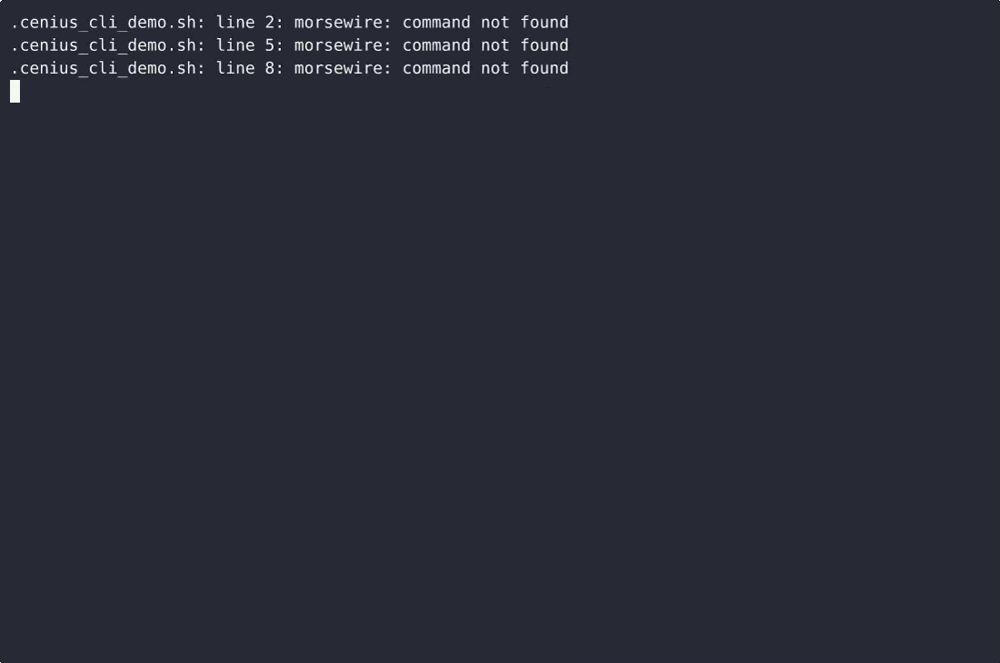

# MorseWire — complete Full-stack app command-line tool example app

Need a self-hosted command-line tool? **MorseWire** is the open-source answer: a Full-stack app project you can clone, run, and own. MorseWire is a single-file, standard-library-only Python command-line drill for Morse code copying: you give it a phrase (flag or prompt), it encodes the phrase into correctly timed Morse, renders it as a real audible…. Every MorseWire line of code is here — no stripped demo, no paywalled features. Apache-2.0-licensed; [remix MorseWire on cenius.ai](https://cenius.ai/marketplace/p/morsewire?ref=gh&utm_campaign=morsewire-webapp) for a bespoke custom version.


[](LICENSE)  [](https://cenius.ai)

[](https://cenius.ai/marketplace/p/morsewire?ref=gh&utm_campaign=morsewire-webapp)

> **▶ [Open & edit in cenius.ai](https://cenius.ai/marketplace/p/morsewire?ref=gh&utm_campaign=morsewire-webapp)** — one click to an editable workspace: describe changes in plain English, get an instant preview, one-click deploy and host. Modifications made on the platform come with full rebrand & relicense rights.

_Local clone? See [Quick start](#quick-start) below. cenius.ai is the zero-setup path._

## Demo


▶ **[See it in action](https://cenius.ai/marketplace/p/morsewire?ref=gh&utm_campaign=morsewire-webapp)** — full demo on the project page · [MP4](.github/media/demo.mp4)

## Screenshots



## Architecture

Open the repo and you'll find a complete Full-stack app application (17 files). Top-level layout: `examples/`, `tests/`. `./install.sh` gets you from a fresh clone to a running instance with sample data in a single step. Full setup details: [`INSTALL.md`](INSTALL.md).

## Features

- Receive/copy drill round
- Audible Morse playback with visual fallback
- Speed ramp per session
- Accuracy scoring and persistent history
- Phrase input and validation

## Quick start

```bash
./install.sh   # installs dependencies + seeds demo data
```

See [`INSTALL.md`](INSTALL.md) for full setup and usage instructions.

## Usage guide

A session is: pick a phrase once, then copy it back from Morse over and over
while the speed climbs. Every scored round lands in your history file.

### Flags

| Flag | Default | What it does |
| --- | --- | --- |
| `--start-wpm N` | 12 | speed of round 1, 5–60 WPM |
| `--ramp N` | 2 | WPM added after each scored round, 1–20 |
| `--max-wpm N` | 25 | speed cap, must be ≥ `--start-wpm` |
| `--no-audio` | off | never probe or play audio; draw the Morse instead |
| `--history` | — | print stored rounds, then exit 0 |
| `--list-chars` | — | print the supported characters, then exit 0 |
| `--help`, `--version` | — | usage and version, then exit 0 |

Exit codes: `0` success (including quitting mid-drill), `2` bad usage.

### Phrase entry

```
Type a phrase, then copy it back each round. 'quit' exits.
e.g. PARIS THE QUICK BROWN FOX
Phrase to drill: hello!
Skipping unsupported: !
Drilling: HELLO at 12 WPM (ramp +2, cap 25)
```

* blank or whitespace-only input re-asks: `Please type at least one character.`
* over 60 characters re-asks and says how long the phrase was
* a phrase with no supported characters re-asks with a pointer to `--list-chars`
* `quit` (any case) leaves immediately — nothing is written to history

### A round

Audio available:

```
Round 1 — 12 WPM — audio
sending...
type what you copied: paris the quick brown fox
```

No player, or `--no-audio`:

```
Round 2 — 14 WPM — visual
No audio player found — this round is visual-only.
  .--. .- .-. .. ... / - .... . / --.- ..- .. -.-. -.- / -... .-. --- .-- -.
  / ..-. --- -..-
type what you copied:
```

_Full guide: [`USAGE.md`](USAGE.md)_

## FAQ

### How do I run MorseWire on my own server?

Grab the repo and run `./install.sh` — it handles packages and seed data in one go. After that, [`INSTALL.md`](INSTALL.md) walks you through starting the server. No external accounts required.

### What is MorseWire built with?

The app is built with Full-stack app. What you see in this repo is the full production source, demo data included. Highlights include accuracy scoring and persistent history.

### Can I build a business on MorseWire?

Yes. The code is Apache-2.0-licensed — use it, modify it, and ship it commercially. See [LICENSE](LICENSE).

### Can I rebrand or white-label MorseWire?

Absolutely. [Open it on cenius.ai](https://cenius.ai/marketplace/p/morsewire?ref=gh&utm_campaign=morsewire-webapp) and remix it there — platform modifications come with full rebrand and relicense rights over your derivative, so the result is entirely yours.

### How can I customize MorseWire without editing code?

[cenius.ai](https://cenius.ai/marketplace/p/morsewire?ref=gh&utm_campaign=morsewire-webapp) handles the implementation. Tell it what you want in everyday words, pick up the updated build. No coding needed.

## License & rebranding

Released under the [Apache License 2.0](LICENSE) (© 2026 Cenius AI) — free for personal and commercial use. The Cenius name/logo are trademarks (see NOTICE).

**Need a customized version?** [Remix this app on cenius.ai](https://cenius.ai/marketplace/p/morsewire?ref=gh&utm_campaign=morsewire-webapp) — modifications made on the platform come with **full rebrand & relicense rights** over your derivative.

## Built with cenius.ai

This entire application — code, design, seeded demo data — was generated on **[cenius.ai](https://cenius.ai)** from a plain-English description.

- 🚀 [Build your own app on cenius.ai](https://cenius.ai)
- 🎛️ [Remix MorseWire on the marketplace](https://cenius.ai/marketplace/p/morsewire?ref=gh&utm_campaign=morsewire-webapp) — open it in a workspace, prompt for changes, and ship your own version.

More open-source apps: [the Cenius-ai catalog](https://github.com/Cenius-ai) · [showcase index](https://github.com/Cenius-ai/showcase)
